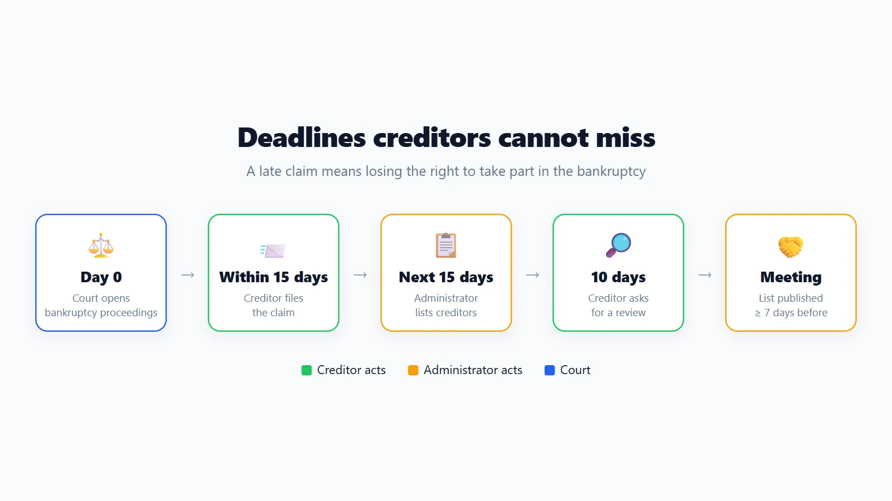

As an assistant to an insolvency administrator, a large part of my job is **receiving creditors' claims** and building the list of creditors. Some creditors file very well-prepared claims. Many others lose out simply because they **filed a few days late** or **lacked evidence**. The debt is real, but a creditor who is not on the list has almost no say in the bankruptcy.

My [previous post](/en/blog/huong-dan-chu-no-nop-don-yeu-cau-mo-thu-tuc-pha-san) covered petitioning for a debtor's bankruptcy. This post is the next step: **once the court has opened bankruptcy proceedings, what must a creditor do to protect its claim**, under Vietnam's Law on Restructuring and Bankruptcy No. 142/2025/QH15 (in force since 1 March 2026).

## Filing claims in 2026: the key changes

| Item | 2014 Law on Bankruptcy | 2025 Law on Restructuring and Bankruptcy |
|---|---|---|
| Deadline to file a claim | **30 days** (Article 66) | **15 days** from the court's decision to open proceedings (Article 55) |
| Late filing | Often accepted in practice | **Creditor loses the right to take part in the proceedings** |
| Exception | Force majeure time not counted | Force majeure or objective obstacles: may be added before the court declares bankruptcy |
| Publishing the creditor list | Debtor's office, court portal… | **National portal on restructuring and bankruptcy**, at least 7 days before the creditors' meeting |
| Asking for a review of the list | 5 working days | **10 days** from publication of the list |
| Who chairs the creditors' meeting | The judge | **The insolvency administrator** |

The key takeaway: **the deadline has been cut in half, and the consequence of filing late is far more serious.**

## Who needs to file a claim

- **Every creditor** of the business in bankruptcy: unsecured, partially secured and secured.
- **Including the creditor that petitioned for the bankruptcy.** Many assume the court already knows about their debt from the petition, but the petition and the claim are two different things. File a complete claim to make sure you are on the list.
- **Creditors with new debts** arising after proceedings open: declare them within **3 working days** of the debt arising.

## 1. Know when proceedings are opened

The 15 days run **from the date of the court's decision**, not from the date you hear about it. Creditors need to keep watch through:

- Notices from the court or the administrator to known creditors (sent to addresses in the debtor's records).
- The **national portal on restructuring and bankruptcy**, where the new law requires case information to be published.
- The debtor itself, other creditors, or the debtor's employees.

If you have a hard-to-collect debt with a business in financial trouble, check regularly. Many creditors find out when the deadline is almost over.

## 2. The claim file

### What the claim should state

- Creditor details: name, address, enterprise code or ID number, representative, phone, email.
- The debtor's name and the number and date of the decision to open bankruptcy proceedings.
- **The amount owed, with principal and interest shown separately**, plus how and from when interest is calculated.
- The basis of the debt (contract no., invoice no.).
- Whether the debt is **secured**; if so, a description of the collateral and its registration documents.
- Bank account details for payment.
- Signature of an authorised person, and company seal if the creditor is an organisation.

### Sample template

The claim is filed in Vietnamese. This English version is only to show the structure.

```text
SOCIALIST REPUBLIC OF VIETNAM
Independence – Freedom – Happiness

CREDITOR'S CLAIM

To: Insolvency administrator [name] / Asset management and liquidation enterprise [name]
Bankruptcy case: [debtor company name]
Under the Decision to open bankruptcy proceedings No. …/… dated …/…/… of the … Court

1. Creditor: [name], enterprise code/ID no.: …
   Address: …   Representative: …   Phone/email: …
2. Amount claimed:
   - Principal: VND …
   - Interest: VND … (from …/…/… to …/…/…, at …% per year)
   - Total: VND …
3. Basis: Contract No. … dated …; invoice No. …; debt reconciliation dated …
4. Collateral: None / Yes: [description, registration documents]
5. Payment account: [account number, bank]

Attachments: [list]
                                        …, date …
                                        CREDITOR (signature, full name, seal)
```

Treat this as a reference only. Check whether the court or the administrator provides its own form for the case.

### Supporting documents

- The contract and any appendices.
- Invoices, delivery notes, acceptance and liquidation records.
- The most recent **debt reconciliation statement**.
- Any court judgment, decision or arbitral award on the debt.
- Collateral documents (if any).
- A power of attorney if the signatory is not the legal representative.

**For foreign creditors:** documents in a foreign language generally need a Vietnamese translation, and documents issued abroad may need consular legalisation. Start early, because this can take longer than 15 days.

## 3. Who to send it to and how

- **Send it to the insolvency administrator** or the asset management and liquidation enterprise appointed by the court, **not to the court**. This is a mistake I see often.
- The administrator's details are in the decision to open bankruptcy proceedings.
- Use a method that **proves the date you sent it**: deliver it in person and get a receipt, or use registered post and keep the slip. If the administrator accepts email or an electronic portal, keep the email and a screenshot of the confirmation.
- **Don't wait until the last day.** File early so you have time to add documents if asked.

## 4. After filing: the creditor list and the creditors' meeting

### Deadlines to track



1. **The administrator lists the creditors** within 15 days after the claim deadline.
2. **The list is published** on the national portal on restructuring and bankruptcy, at least 7 days before the creditors' meeting.
3. **Check your name and amount.** If anything is wrong or missing, ask for a review within **10 days** of the list being published.

### The creditors' meeting

- The 2025 law **removes the minimum 51% attendance requirement** for the meeting to be valid, and the administrator now chairs it.
- A resolution passes when creditors holding **at least 65% of total unsecured debt** vote in favour.
- If the meeting cannot pass a resolution on restructuring or bankruptcy, the court declares the debtor bankrupt.

With no attendance threshold, **absent creditors can be outvoted**. Attend the meeting or appoint someone to attend for you.

## 5. Mistakes I see most often when receiving claims

- **Filing late** by counting the 15 days from when the creditor heard the news instead of from the court's decision.
- **Sending the claim to the court** instead of the administrator.
- **Stating only a total**, without separating principal and interest or showing the interest calculation.
- **Attaching no evidence**, or only the contract without invoices or delivery records.
- **Not mentioning collateral** on a secured debt, which affects how it is treated.
- **An unauthorised signatory**, with no power of attorney attached.
- **Not checking the creditor list** after filing, and missing the deadline to ask for a review.

## Checklist for filing your claim

- [ ] You know the number and date of the decision to open proceedings
- [ ] You have worked out the deadline: **15 days from the court's decision**
- [ ] You have identified the correct administrator or liquidation enterprise
- [ ] The claim separates principal, interest and the interest calculation
- [ ] The claim states whether the debt is secured
- [ ] The contract, invoices and debt reconciliation are attached
- [ ] The signatory is authorised or has a power of attorney
- [ ] You have proof of the filing date (receipt, postal slip, email)
- [ ] You have a reminder to check the creditor list on the national portal
- [ ] You are ready to attend, or appoint someone to attend, the creditors' meeting

## Conclusion

Under Vietnam's 2025 bankruptcy law, **15 days** decide whether a creditor still has a say in the bankruptcy. Filing on time, with the right person and with full evidence, then tracking the creditor list, is the surest way to protect your claim. If you need help drafting a claim or reviewing your debt file, see the [services](/en/services) I offer or [get in touch](/en/contact).

*This post is for general information and is current as of November 2026. Every case has its own facts, so check the full text of the law and Resolution 02/2026/NQ-HĐTP, or consult a lawyer.*

## References

- [Law on Restructuring and Bankruptcy No. 142/2025/QH15 (Thư viện Pháp luật, in Vietnamese)](https://thuvienphapluat.vn/van-ban/Doanh-nghiep/Luat-Phuc-hoi-pha-san-2025-so-142-2025-QH15-675210.aspx)
- [Law on Recovery and Bankruptcy No. 142/2025/QH15 (LuatVietnam, English translation)](https://english.luatvietnam.vn/law-on-recovery-and-bankruptcy-dated-december-11-2025-of-the-national-assembly-no-142-2025-qh15-422653-doc1.html)
- [Resolution 02/2026/NQ-HĐTP guiding the Law (LuatVietnam, in Vietnamese)](https://luatvietnam.vn/doanh-nghiep/nghi-quyet-02-2026-nq-hdtp-huong-dan-luat-phuc-hoi-pha-san-hieu-luc-tu-01-06-2026-436123-d1.html)
- [Bankruptcy procedure reform: a leaner, more efficient process (in Vietnamese)](https://www.tapsanluatsunoibo.com/cai-cach-thu-tuc-pha-san-buoc-tien-moi-tinh-gon-va-hieu-qua-hon/)
