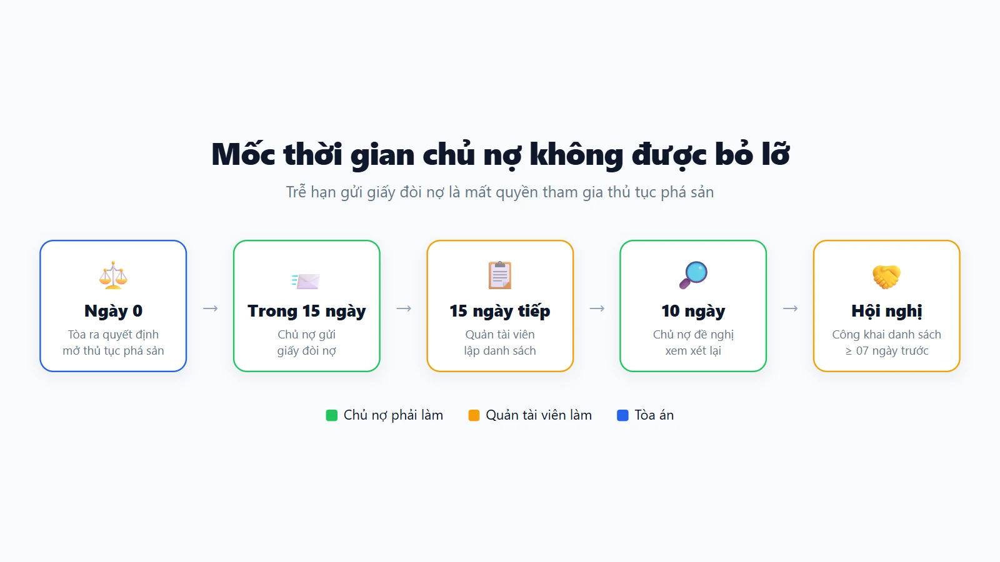

Làm Trợ lý Quản tài viên, một phần lớn công việc của mình là **tiếp nhận giấy đòi nợ** và lập danh sách chủ nợ. Có chủ nợ gửi rất chỉn chu, nhưng cũng có nhiều trường hợp mất quyền lợi chỉ vì **gửi trễ vài ngày** hoặc **thiếu chứng cứ**. Khoản nợ có thật, nhưng không vào được danh sách chủ nợ thì gần như không có tiếng nói trong vụ phá sản.

[Bài trước](/blog/huong-dan-chu-no-nop-don-yeu-cau-mo-thu-tuc-pha-san) mình viết về việc nộp đơn yêu cầu mở thủ tục phá sản. Bài này là bước tiếp theo: **khi Tòa án đã mở thủ tục phá sản, chủ nợ phải làm gì để giữ quyền đòi nợ**, theo Luật Phục hồi, phá sản số 142/2025/QH15 (hiệu lực từ 01/3/2026).

## Giấy đòi nợ 2026 qua vài thay đổi chính

| Nội dung | Luật Phá sản 2014 | Luật Phục hồi, phá sản 2025 |
|---|---|---|
| Thời hạn gửi giấy đòi nợ | **30 ngày** (Điều 66) | **15 ngày** kể từ ngày Tòa ra quyết định mở thủ tục (Điều 55) |
| Gửi chậm | Thực tế thường được bổ sung | **Mất quyền tham gia thủ tục phá sản** |
| Ngoại lệ | Không tính thời gian bất khả kháng | Bất khả kháng, trở ngại khách quan: được bổ sung trước khi Tòa tuyên bố phá sản |
| Công khai danh sách chủ nợ | Trụ sở doanh nghiệp, cổng thông tin của Tòa… | **Cổng thông tin điện tử quốc gia** về phục hồi, phá sản, tối thiểu 07 ngày trước Hội nghị chủ nợ |
| Đề nghị xem xét lại danh sách | 05 ngày làm việc | **10 ngày** kể từ ngày công khai danh sách |
| Người điều hành Hội nghị chủ nợ | Thẩm phán | **Quản tài viên** |

Điểm cần nhớ nhất: **thời hạn đã giảm một nửa, và hậu quả của việc gửi trễ nặng hơn hẳn.**

## Ai cần gửi giấy đòi nợ

- **Mọi chủ nợ** của doanh nghiệp bị mở thủ tục phá sản: chủ nợ không có bảo đảm, có bảo đảm một phần và có bảo đảm.
- **Kể cả chủ nợ đã nộp đơn yêu cầu mở thủ tục.** Nhiều người nghĩ đã nộp đơn thì Tòa đã biết khoản nợ, nhưng đơn yêu cầu và giấy đòi nợ là hai việc khác nhau. Nên gửi giấy đòi nợ đầy đủ để chắc chắn có tên trong danh sách.
- **Chủ nợ có khoản nợ phát sinh mới** sau khi mở thủ tục: kê khai trong **03 ngày làm việc** kể từ ngày phát sinh.

## 1. Biết khi nào thủ tục phá sản được mở

Thời hạn 15 ngày tính **từ ngày Tòa án ra quyết định**, không phải từ ngày bạn biết tin. Vì vậy chủ nợ cần chủ động theo dõi:

- Văn bản Tòa án hoặc Quản tài viên gửi cho chủ nợ đã biết (theo địa chỉ trong sổ sách của doanh nghiệp nợ).
- **Cổng thông tin điện tử quốc gia về phục hồi, phá sản**, nơi luật mới yêu cầu công khai thông tin vụ việc.
- Thông tin từ chính doanh nghiệp nợ, các chủ nợ khác, hoặc người lao động của doanh nghiệp đó.

Nếu bạn đang có khoản nợ khó đòi với một doanh nghiệp làm ăn khó khăn, nên kiểm tra định kỳ. Nhiều chủ nợ biết tin khi thời hạn đã gần hết.

## 2. Hồ sơ giấy đòi nợ

### Giấy đòi nợ cần ghi rõ

- Thông tin chủ nợ: tên, địa chỉ, mã số doanh nghiệp hoặc số CCCD, người đại diện, số điện thoại, email.
- Tên doanh nghiệp nợ và số, ngày quyết định mở thủ tục phá sản.
- **Số tiền nợ, tách riêng nợ gốc và lãi**, cách tính lãi và mốc tính.
- Căn cứ phát sinh khoản nợ (hợp đồng số…, hóa đơn số…).
- Khoản nợ **có bảo đảm hay không**; nếu có, mô tả tài sản bảo đảm và giấy tờ đăng ký biện pháp bảo đảm.
- Thông tin tài khoản nhận tiền.
- Chữ ký của người có thẩm quyền và con dấu (nếu là tổ chức).

### Mẫu tham khảo

```text
CỘNG HÒA XÃ HỘI CHỦ NGHĨA VIỆT NAM
Độc lập – Tự do – Hạnh phúc

GIẤY ĐÒI NỢ

Kính gửi: Quản tài viên [tên] / Doanh nghiệp quản lý, thanh lý tài sản [tên]
Vụ việc phá sản: Công ty [tên doanh nghiệp nợ]
Theo Quyết định mở thủ tục phá sản số …/… ngày …/…/… của Tòa án …

1. Chủ nợ: [tên], mã số doanh nghiệp/CCCD: …
   Địa chỉ: …   Người đại diện: …   Điện thoại/email: …
2. Khoản nợ:
   - Nợ gốc: … đồng
   - Lãi: … đồng (tính từ …/…/… đến …/…/…, lãi suất …%/năm)
   - Tổng cộng: … đồng
3. Căn cứ: Hợp đồng số … ngày …; hóa đơn số …; biên bản đối chiếu công nợ ngày …
4. Tài sản bảo đảm: Không có / Có: [mô tả, giấy tờ đăng ký]
5. Tài khoản nhận thanh toán: [số tài khoản, ngân hàng]

Tài liệu kèm theo: [liệt kê]
                                        …, ngày … tháng … năm …
                                        CHỦ NỢ (ký, ghi rõ họ tên, đóng dấu)
```

Mẫu trên chỉ để tham khảo. Nên đối chiếu với mẫu Tòa án hoặc Quản tài viên cung cấp trong từng vụ việc (nếu có).

### Tài liệu chứng minh khoản nợ

- Hợp đồng, phụ lục hợp đồng.
- Hóa đơn, phiếu giao hàng, biên bản nghiệm thu, thanh lý.
- **Biên bản đối chiếu công nợ** gần nhất.
- Bản án, quyết định của Tòa án hoặc phán quyết trọng tài (nếu khoản nợ đã được giải quyết).
- Giấy tờ về tài sản bảo đảm (nếu có).
- Giấy ủy quyền, nếu người ký không phải người đại diện theo pháp luật.

## 3. Gửi cho ai và gửi thế nào

- **Gửi cho Quản tài viên hoặc doanh nghiệp quản lý, thanh lý tài sản** được Tòa án chỉ định, **không gửi cho Tòa án**. Đây là lỗi mình gặp khá thường xuyên.
- Thông tin Quản tài viên có trong quyết định mở thủ tục phá sản.
- Nên gửi bằng cách **có bằng chứng ngày gửi**: nộp trực tiếp và lấy giấy biên nhận, hoặc gửi bưu điện bảo đảm và giữ biên lai. Nếu Quản tài viên nhận qua email hoặc cổng điện tử, lưu lại email và ảnh chụp xác nhận.
- **Đừng đợi đến ngày cuối.** Gửi sớm để còn thời gian bổ sung nếu bị yêu cầu.

## 4. Sau khi gửi: danh sách chủ nợ và Hội nghị chủ nợ

### Mốc thời gian cần theo dõi



1. **Quản tài viên lập danh sách chủ nợ** trong 15 ngày kể từ ngày hết hạn gửi giấy đòi nợ.
2. **Danh sách được công khai** trên Cổng thông tin điện tử quốc gia về phục hồi, phá sản, tối thiểu 07 ngày trước Hội nghị chủ nợ.
3. **Kiểm tra tên và số tiền của mình.** Nếu sai hoặc thiếu, đề nghị xem xét lại trong **10 ngày** kể từ ngày công khai danh sách.

### Hội nghị chủ nợ

- Luật 2025 **bỏ điều kiện tối thiểu 51%** số nợ tham dự để Hội nghị hợp lệ, và Quản tài viên là người điều hành.
- Nghị quyết được thông qua khi chủ nợ đại diện **từ 65% tổng số nợ không có bảo đảm** trở lên tán thành.
- Nếu Hội nghị không thông qua được nghị quyết về phục hồi hoặc phá sản, Tòa án sẽ tuyên bố phá sản.

Vì không còn ngưỡng tham dự, **chủ nợ vắng mặt có thể bị quyết định thay**. Nên tham dự hoặc ủy quyền cho người tham dự.

## 5. Những lỗi mình hay gặp khi tiếp nhận giấy đòi nợ

- **Gửi trễ hạn** vì tính 15 ngày từ ngày biết tin thay vì từ ngày Tòa ra quyết định.
- **Gửi nhầm cho Tòa án** thay vì Quản tài viên.
- **Chỉ ghi tổng số tiền**, không tách gốc, lãi và không có cách tính lãi.
- **Không đính kèm chứng cứ**, hoặc chỉ có hợp đồng mà không có hóa đơn, biên bản giao nhận.
- **Không nêu tài sản bảo đảm** dù khoản nợ có bảo đảm, làm ảnh hưởng thứ tự xử lý.
- **Người ký không có thẩm quyền**, không kèm giấy ủy quyền.
- **Không theo dõi danh sách chủ nợ** sau khi gửi nên bỏ lỡ thời hạn đề nghị xem xét lại.

## Checklist gửi giấy đòi nợ

- [ ] Đã biết số, ngày quyết định mở thủ tục phá sản
- [ ] Đã tính đúng hạn chót: **15 ngày từ ngày Tòa ra quyết định**
- [ ] Đã xác định đúng Quản tài viên hoặc doanh nghiệp quản lý, thanh lý tài sản
- [ ] Giấy đòi nợ tách rõ nợ gốc, lãi và cách tính
- [ ] Đã ghi rõ khoản nợ có hay không có bảo đảm
- [ ] Đính kèm hợp đồng, hóa đơn, biên bản đối chiếu công nợ
- [ ] Người ký có thẩm quyền hoặc có giấy ủy quyền
- [ ] Giữ bằng chứng ngày gửi (biên nhận, biên lai bưu điện, email)
- [ ] Đặt lịch kiểm tra danh sách chủ nợ trên Cổng thông tin quốc gia
- [ ] Chuẩn bị tham dự hoặc ủy quyền tham dự Hội nghị chủ nợ

## Kết

Với Luật Phục hồi, phá sản 2025, **15 ngày** là khoảng thời gian quyết định chủ nợ có còn quyền lợi trong vụ phá sản hay không. Gửi đúng hạn, đúng người, đủ chứng cứ, rồi theo dõi danh sách chủ nợ là cách chắc chắn nhất để giữ quyền đòi nợ.

*Bài viết mang tính tham khảo, cập nhật đến tháng 11/2026. Mỗi vụ việc có tình tiết riêng, nên đối chiếu toàn văn luật, Nghị quyết 02/2026/NQ-HĐTP hoặc hỏi ý kiến luật sư.*

## Nguồn tham khảo

- [Luật Phục hồi, phá sản 2025 số 142/2025/QH15 (Thư viện Pháp luật)](https://thuvienphapluat.vn/van-ban/Doanh-nghiep/Luat-Phuc-hoi-pha-san-2025-so-142-2025-QH15-675210.aspx)
- [Nghị quyết 02/2026/NQ-HĐTP hướng dẫn Luật Phục hồi, phá sản (LuatVietnam)](https://luatvietnam.vn/doanh-nghiep/nghi-quyet-02-2026-nq-hdtp-huong-dan-luat-phuc-hoi-pha-san-hieu-luc-tu-01-06-2026-436123-d1.html)
- [Cải cách thủ tục phá sản: bước tiến mới tinh gọn và hiệu quả hơn (Tập san Luật sư nội bộ)](https://www.tapsanluatsunoibo.com/cai-cach-thu-tuc-pha-san-buoc-tien-moi-tinh-gon-va-hieu-qua-hon/)
- [Quản tài viên phải lập danh sách chủ nợ trong thời hạn bao lâu (Thư viện Pháp luật)](https://thuvienphapluat.vn/lao-dong-tien-luong/quan-tai-vien-phai-lap-danh-sach-chu-no-trong-thoi-han-bao-lau-ke-tu-ngay-het-han-gui-giay-doi-no-27153.html)
