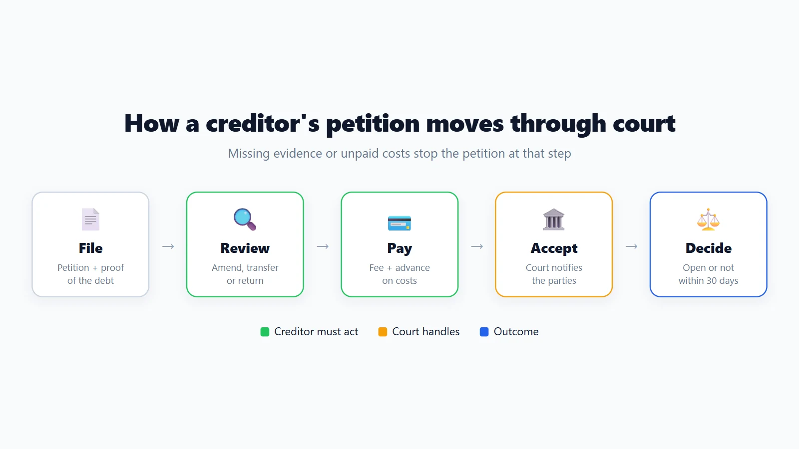

In nearly 1.5 years as an assistant to an insolvency administrator, I have heard the same question from creditors again and again: *"They haven't paid us for months. Can we file for their bankruptcy?"* The short answer: **yes, if the conditions are met and the evidence is solid**. But bankruptcy is not a fast way to collect a debt, and since **1 March 2026** the rules have changed significantly.

This post summarises what creditors need to know under Vietnam's **Law on Restructuring and Bankruptcy No. 142/2025/QH15**, which replaced the 2014 Law on Bankruptcy.

## Vietnam's bankruptcy law in 2026: the key changes

| Item | 2014 Law on Bankruptcy | 2025 Law on Restructuring and Bankruptcy |
|---|---|---|
| When a business is insolvent | Debt unpaid **3 months** after due date | Debt unpaid **6 months** after due date |
| Who may file | Creditors, employees, trade unions, shareholders… | Adds **tax authorities** and **social insurance agencies** |
| How to file | In person or by post | Adds **online filing**, electronic payment and documents |
| Advance on costs | Paid by the petitioner (except employees and unions) | State budget also advances it for tax and social insurance agencies, and when the debtor has no assets |
| Small debtors with few creditors | Ordinary procedure | New **simplified procedure** with shorter deadlines |
| Business restructuring | Part of the bankruptcy procedure | A **separate procedure** that can be used earlier |

## When to file (and when not to)

**Consider filing a bankruptcy petition when:**

- The debtor has effectively stopped operating and cannot be reached.
- There are signs of assets being hidden or moved, and early court intervention is needed.
- Several creditors are owed money and want the assets shared fairly under the law.

**Consider a debt-collection lawsuit instead when:**

- The debtor is still operating normally and is simply refusing to pay you.
- The debt is small and bankruptcy costs could exceed what you recover.
- The debt has not yet been overdue for a full 6 months.

## 1. Conditions for a creditor to file

A creditor must meet **both** conditions:

1. **Standing:** you are an **unsecured** or **partially secured** creditor. A fully secured creditor enforces its collateral instead.
2. **The debt:** the business or cooperative is **insolvent**, meaning it has not paid a due debt **within 6 months of the due date** (Article 5).

This is the point I see creditors get wrong most often. The old law required only 3 months. If you file when the debt is only 4–5 months overdue, the petition is likely to be returned.

## 2. Documents to prepare

Under Article 39, a creditor's file includes:

- **The petition to open bankruptcy proceedings**, stating the date; the creditor's name and address; the name and head-office address of the debtor; the amount owed, the due date and the fact that it was not paid.
- **Proof of the debt:** contracts, invoices, delivery notes, acceptance records and a **debt reconciliation statement**.
- **Proof the debt is 6 months overdue:** documents showing the payment deadline, reminder letters or emails, and bank statements showing no payment.
- **Proof of the petitioner's standing:** business registration certificate or ID card, plus a power of attorney if filing through a representative.

From my experience preparing these files, a **debt reconciliation statement signed and sealed by the debtor** is the strongest evidence. If you don't have one, send a written request to confirm the debt before filing.

## 3. Where and how to file

- **Where:** the competent People's Court for bankruptcy matters where the debtor has its **head office**. Vietnam's court system was reorganised in 2025, so check in advance which court currently handles bankruptcy cases in that province or city.
- **How:** in person, by post, or **online**.

## 4. Costs

| Item | Paid to | Notes |
|---|---|---|
| Bankruptcy fee | Civil judgment enforcement agency | Currently VND 1,500,000 (Resolution 326/2016/UBTVQH14); check for newer rules |
| Advance on bankruptcy costs | The court's bank account | Set by the court, usually many times higher than the fee |

The court **only accepts the case** once both payments are proven. The state budget advances the costs when the petitioner is an employee, a trade union, a tax authority or a social insurance agency, or when the debtor has no assets left.

## 5. How the court handles the petition

### The path of a petition

1. **Receipt:** the Chief Judge assigns a judge to the case.
2. **Review:** the judge may ask you to amend or supplement the petition, transfer it to the competent court, or return it.
3. **Payment:** the creditor pays the fee and the advance on costs within the deadline the court sets.
4. **Acceptance:** the court notifies the debtor and other interested parties.
5. **Decision:** the judge decides **whether or not to open** bankruptcy proceedings within **30 days** of accepting the case.

### Simplified procedure

If the debtor has few creditors or small debts, is a small or micro enterprise, or has no assets left, the case may follow the **simplified procedure**, with much shorter deadlines than the ordinary procedure.

## 6. What creditors should understand before filing

- **Bankruptcy is not fast debt collection.** Assets are distributed in a statutory order: bankruptcy costs, employees' wages, taxes and others come first. Unsecured creditors usually recover only part of what they are owed.
- **Once proceedings open, you must send your claim** to the insolvency administrator on time. A late claim can cost you the right to take part in the creditors' meeting.
- **File in good faith.** A petitioner who files dishonestly may have to compensate the debtor for its losses.
- **Keep evidence from day one.** Missing evidence is the most common reason a petition is sent back for more documents or returned.

## Checklist before filing

- [ ] The debt has been overdue for **a full 6 months** from its due date
- [ ] You are clearly an unsecured or partially secured creditor
- [ ] You have the contract, invoices and delivery documents
- [ ] You have a debt reconciliation statement or a written acknowledgement of the debt
- [ ] You have reminder letters or emails showing the debt was not paid
- [ ] You have checked the debtor's current head-office address
- [ ] You have identified the competent court
- [ ] You have funds ready for the fee and the advance on bankruptcy costs
- [ ] You have a power of attorney (if filing through a representative)

## Conclusion

A bankruptcy petition is a powerful tool when the debtor is genuinely insolvent, but it only works with a solid file and the right timing. If you have a hard-to-collect debt and aren't sure whether to sue or petition for bankruptcy, see the [services](/en/services) I offer or [get in touch](/en/contact) to discuss your case.

*This post is for general information and is current as of November 2026. Every case has its own facts, so check the full text of the law or consult a lawyer before filing.*

## References

- [Law on Restructuring and Bankruptcy No. 142/2025/QH15 (Thư viện Pháp luật, in Vietnamese)](https://thuvienphapluat.vn/van-ban/Doanh-nghiep/Luat-Phuc-hoi-pha-san-2025-so-142-2025-QH15-675210.aspx)
- [Key new points of the Law on Restructuring and Bankruptcy (Court Journal, in Vietnamese)](https://tapchitoaan.vn/gioi-thieu-mot-so-diem-moi-co-ban-cua-luat-phuc-hoi-pha-san14804.html)
- [Insolvency threshold extended from 1 March 2026 (Thư viện Pháp luật, in Vietnamese)](https://thuvienphapluat.vn/chinh-sach-phap-luat-moi/vn/ho-tro-phap-luat/chinh-sach-moi/106376/tang-thoi-han-xac-dinh-doanh-nghiep-mat-kha-nang-thanh-toan-de-mo-thu-tuc-pha-san-tu-01-3-2026)
- [Bankruptcy procedure under the Law on Restructuring and Bankruptcy (ATI Law, in Vietnamese)](https://atilaw.com.vn/thu-tuc-pha-san-theo-quy-dinh-cua-luat-phuc-hoi-pha-san/)
