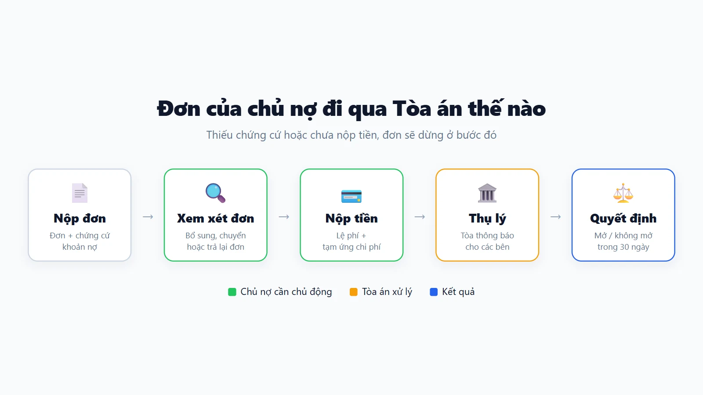

Gần 1,5 năm làm Trợ lý Quản tài viên, mình gặp khá nhiều chủ nợ hỏi cùng một câu: *"Bên kia nợ mấy tháng không trả, giờ nộp đơn phá sản được không?"*. Câu trả lời ngắn: **được, nếu đủ điều kiện và đủ chứng cứ**. Nhưng phá sản không phải cách đòi nợ nhanh, và từ ngày **01/3/2026** luật đã thay đổi khá nhiều.

Bài này tổng hợp những gì chủ nợ cần nắm theo **Luật Phục hồi, phá sản số 142/2025/QH15**, luật thay thế Luật Phá sản 2014.

## Luật phá sản 2026 qua vài thay đổi chính

| Hạng mục | Luật Phá sản 2014 | Luật Phục hồi, phá sản 2025 |
|---|---|---|
| Thời điểm mất khả năng thanh toán | Quá hạn **03 tháng** không trả | Quá hạn **06 tháng** không trả |
| Người có quyền nộp đơn | Chủ nợ, người lao động, công đoàn, cổ đông… | Thêm **cơ quan thuế** và **cơ quan bảo hiểm xã hội** |
| Cách nộp đơn | Trực tiếp hoặc bưu chính | Thêm **nộp trực tuyến**, nộp tiền và tài liệu điện tử |
| Tạm ứng chi phí | Người nộp đơn nộp (trừ người lao động, công đoàn) | Ngân sách tạm ứng thêm cho cơ quan thuế, BHXH và doanh nghiệp hết tài sản |
| Doanh nghiệp nhỏ, ít chủ nợ | Thủ tục thông thường | Có **thủ tục rút gọn**, thời hạn ngắn hơn |
| Phục hồi doanh nghiệp | Nằm trong thủ tục phá sản | Thành **thủ tục riêng**, áp dụng sớm hơn |

## Khi nào nên (và không nên) nộp đơn phá sản

**Nên cân nhắc nộp đơn khi:**

- Doanh nghiệp nợ đã ngừng hoạt động thực tế, liên lạc không được.
- Có dấu hiệu tẩu tán tài sản, cần Tòa án can thiệp sớm.
- Nhiều chủ nợ cùng bị nợ, muốn tài sản được chia công bằng theo luật.

**Nên cân nhắc khởi kiện đòi nợ thay vì phá sản khi:**

- Doanh nghiệp vẫn hoạt động bình thường, chỉ chây ì với riêng mình.
- Khoản nợ nhỏ, chi phí phá sản có thể lớn hơn số tiền thu về.
- Khoản nợ chưa quá hạn đủ 06 tháng.

## 1. Điều kiện để chủ nợ được nộp đơn

Chủ nợ phải đáp ứng **cả hai** điều kiện:

1. **Tư cách:** là chủ nợ **không có bảo đảm** hoặc **có bảo đảm một phần**. Chủ nợ có tài sản bảo đảm đầy đủ thì đi theo hướng xử lý tài sản bảo đảm.
2. **Khoản nợ:** doanh nghiệp, hợp tác xã **mất khả năng thanh toán**, tức không trả khoản nợ đã đến hạn **sau 06 tháng kể từ ngày đến hạn** (Điều 5).

Đây là điểm mình thấy nhiều người còn nhầm nhất. Luật cũ chỉ cần 03 tháng. Nếu nợ mới quá hạn 4–5 tháng mà nộp đơn, khả năng cao đơn sẽ bị trả lại.

## 2. Hồ sơ cần chuẩn bị

Theo Điều 39, hồ sơ của chủ nợ gồm:

- **Đơn yêu cầu mở thủ tục phá sản**, ghi rõ ngày làm đơn; tên, địa chỉ chủ nợ; tên, địa chỉ trụ sở chính của doanh nghiệp bị yêu cầu; số tiền nợ, ngày đến hạn và việc không thanh toán.
- **Chứng cứ khoản nợ:** hợp đồng, hóa đơn, phiếu giao hàng, biên bản nghiệm thu, **biên bản đối chiếu công nợ**.
- **Chứng cứ nợ đã quá hạn 06 tháng:** chứng từ thể hiện hạn thanh toán, công văn hoặc email nhắc nợ, sao kê không có khoản thanh toán.
- **Giấy tờ tư cách người nộp đơn:** Giấy chứng nhận đăng ký doanh nghiệp hoặc CCCD; giấy ủy quyền nếu nộp qua người đại diện.

Từ kinh nghiệm làm hồ sơ, **biên bản đối chiếu công nợ có chữ ký, con dấu của bên nợ** là chứng cứ mạnh nhất. Nếu chưa có, nên gửi văn bản yêu cầu xác nhận công nợ trước khi nộp đơn.

## 3. Nộp đơn ở đâu, bằng cách nào

- **Nơi nộp:** Tòa án nhân dân có thẩm quyền giải quyết phá sản nơi doanh nghiệp bị yêu cầu **đặt trụ sở chính**. Hệ thống Tòa án đã được sắp xếp lại từ năm 2025, nên kiểm tra trước Tòa nào đang thụ lý việc phá sản ở tỉnh, thành đó.
- **Cách nộp:** trực tiếp, qua bưu chính, hoặc **trực tuyến**.

## 4. Chi phí phải nộp

| Khoản | Nộp ở đâu | Ghi chú |
|---|---|---|
| Lệ phí phá sản | Cơ quan thi hành án dân sự | Mức hiện hành 1.500.000 đồng (Nghị quyết 326/2016/UBTVQH14), cần kiểm tra văn bản mới |
| Tạm ứng chi phí phá sản | Tài khoản Tòa án mở tại ngân hàng | Do Tòa án ấn định, thường cao hơn lệ phí nhiều lần |

Tòa án **chỉ thụ lý** khi đã có chứng từ nộp đủ hai khoản này. Ngân sách nhà nước tạm ứng thay khi người nộp đơn là người lao động, công đoàn, cơ quan thuế, cơ quan bảo hiểm xã hội, hoặc khi doanh nghiệp không còn tài sản.

## 5. Tòa án xử lý đơn như thế nào

### Đường đi của một lá đơn

1. **Nhận đơn:** Chánh án phân công Thẩm phán giải quyết.
2. **Xem xét đơn:** Thẩm phán có thể yêu cầu sửa đổi, bổ sung đơn; chuyển cho Tòa có thẩm quyền; hoặc trả lại đơn.
3. **Nộp tiền:** chủ nợ nộp lệ phí và tạm ứng chi phí trong thời hạn Tòa thông báo.
4. **Thụ lý:** Tòa án thông báo cho doanh nghiệp bị yêu cầu và các bên liên quan.
5. **Quyết định:** Thẩm phán ra quyết định **mở hoặc không mở** thủ tục phá sản trong **30 ngày** kể từ ngày thụ lý.

### Thủ tục rút gọn

Nếu doanh nghiệp có ít chủ nợ, khoản nợ nhỏ, là doanh nghiệp nhỏ, siêu nhỏ, hoặc không còn tài sản, vụ việc có thể đi theo **thủ tục rút gọn**. Thời hạn các bước khi đó ngắn hơn đáng kể so với thủ tục thông thường.

## 6. Những điều chủ nợ cần hiểu trước khi nộp đơn

- **Phá sản không phải đòi nợ nhanh.** Tài sản được chia theo thứ tự luật định: chi phí phá sản, lương người lao động, thuế… đi trước. Chủ nợ không có bảo đảm thường chỉ nhận lại một phần.
- **Sau khi mở thủ tục, chủ nợ phải gửi giấy đòi nợ** cho Quản tài viên đúng hạn. Quá hạn thì có thể mất quyền tham gia Hội nghị chủ nợ.
- **Nộp đơn phải trung thực.** Người nộp đơn không trung thực có thể phải bồi thường thiệt hại cho doanh nghiệp bị yêu cầu.
- **Giữ chứng cứ từ đầu.** Thiếu chứng cứ là lý do phổ biến nhất khiến đơn bị yêu cầu bổ sung hoặc trả lại.

## Checklist trước khi nộp đơn

- [ ] Khoản nợ đã quá hạn **đủ 06 tháng** tính từ ngày đến hạn
- [ ] Xác định rõ mình là chủ nợ không có bảo đảm hoặc có bảo đảm một phần
- [ ] Có hợp đồng, hóa đơn, chứng từ giao nhận
- [ ] Có biên bản đối chiếu công nợ hoặc văn bản bên nợ thừa nhận nợ
- [ ] Có công văn, email nhắc nợ thể hiện việc không thanh toán
- [ ] Kiểm tra địa chỉ trụ sở chính hiện tại của doanh nghiệp nợ
- [ ] Xác định đúng Tòa án có thẩm quyền
- [ ] Chuẩn bị tiền lệ phí và tạm ứng chi phí phá sản
- [ ] Giấy ủy quyền (nếu nộp qua người đại diện)

## Kết

Nộp đơn phá sản là công cụ mạnh khi doanh nghiệp nợ đã thật sự mất khả năng thanh toán, nhưng chỉ hiệu quả khi hồ sơ chặt và chọn đúng thời điểm. Nếu bạn đang có khoản nợ khó đòi và chưa chắc nên khởi kiện hay yêu cầu phá sản, xem các [dịch vụ](/services) mình hỗ trợ hoặc [liên hệ](/contact) để trao đổi cụ thể.

*Bài viết mang tính tham khảo, cập nhật đến tháng 11/2026. Mỗi vụ việc có tình tiết riêng, nên đối chiếu toàn văn luật hoặc hỏi ý kiến luật sư trước khi nộp đơn.*

## Nguồn tham khảo

- [Luật Phục hồi, phá sản 2025 số 142/2025/QH15 (Thư viện Pháp luật)](https://thuvienphapluat.vn/van-ban/Doanh-nghiep/Luat-Phuc-hoi-pha-san-2025-so-142-2025-QH15-675210.aspx)
- [Giới thiệu một số điểm mới cơ bản của Luật Phục hồi, phá sản (Tạp chí Tòa án)](https://tapchitoaan.vn/gioi-thieu-mot-so-diem-moi-co-ban-cua-luat-phuc-hoi-pha-san14804.html)
- [Tăng thời hạn xác định doanh nghiệp mất khả năng thanh toán từ 01/3/2026 (Thư viện Pháp luật)](https://thuvienphapluat.vn/chinh-sach-phap-luat-moi/vn/ho-tro-phap-luat/chinh-sach-moi/106376/tang-thoi-han-xac-dinh-doanh-nghiep-mat-kha-nang-thanh-toan-de-mo-thu-tuc-pha-san-tu-01-3-2026)
- [Thủ tục phá sản theo Luật Phục hồi, phá sản (ATI Law)](https://atilaw.com.vn/thu-tuc-pha-san-theo-quy-dinh-cua-luat-phuc-hoi-pha-san/)
